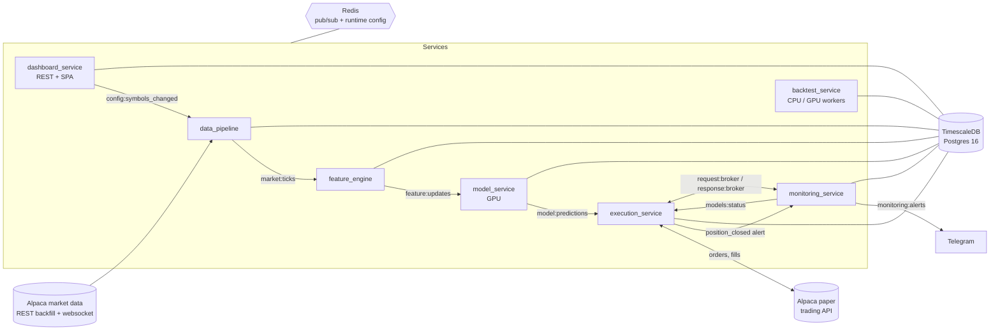

# BullForge

An event-driven, multi-service platform for researching machine-learning trading
signals. It ingests market data from Alpaca, computes features in TimescaleDB,
trains per-symbol models, turns their predictions into orders on an Alpaca **paper**
account, and keeps the local order and trade ledger reconciled with the broker. A
walk-forward backtester replays the same pipeline over history. A monitoring service
compares each model's live accuracy with its hold-out accuracy, disables models that
drift, and raises tiered halt alerts.

> [!IMPORTANT]
> **Paper-trading research platform. Not investment advice.** BullForge was built
> and run only against an Alpaca paper-trading account. This README makes no claims
> about returns or profitability, and nothing here is a recommendation to trade.

Built by Jonathan Farro, April to May 2026. It is shared as a systems and data
engineering portfolio project. Active development stopped on 2026-05-09; see
[Project status](#project-status) and [Known limitations](#known-limitations).

## Highlights

- **Seven async Python services** (asyncio, aiohttp, asyncpg) running as Docker Compose
  containers, each with its own Dockerfile and requirements. They share one library
  (`bullforge/shared/`) for config, DB access, Redis, and the domain models.
- **Redis pub/sub as the event bus.** Services don't call each other over HTTP. There is
  also a small request/response RPC over Redis (correlation IDs on
  `request:broker` / `response:broker:{id}`), so monitoring can query the broker without
  holding its own Alpaca connection.
- **TimescaleDB (Postgres 16) storage** with 25 numbered SQL migrations. Services apply
  them on connect, serialized by a Postgres advisory lock and recorded in a
  `schema_migrations` ledger. Bars, features, labels, and predictions are hypertables.
- **Backtest sandboxing through `search_path`.** A backtest connection resolves
  `backtest.*` tables first, so per-fold writes (orders, model registry, predictions)
  stay out of the live tables while reads of bars and features fall through to `public`.
- **Walk-forward backtesting** with rolling or anchored folds, an embargo gap between
  train and test, next-bar-open fills with slippage, and asset-class-aware volume caps.
  Jobs go into a `backtest_jobs` queue served by separate CPU and GPU worker pools.
- **Broker reconciliation.** Three writers (the submit path, Alpaca's websocket
  trade-updates stream, and a polling sweeper) converge on one idempotent upsert. It
  ingests orphan orders, pairs fills into round-trip trades, and emits anomaly counters.
- **Monitoring and halts.** It compares each model's live accuracy with its
  hold-out accuracy, disables models that drift, evaluates a 4-tier halt policy, and sends operator alerts and
  commands through Telegram.
- **Live runtime config.** Thresholds, symbols, retrain schedule, and model
  hyperparameters live in a Redis hash with a typed schema. The dashboard edits them
  without restarting anything.
- **Tests:** 1,084 tests. 964 are hermetic, and 120 run against a real TimescaleDB and
  Redis. CI runs both sets.

## Architecture



The same flow as plain text (upstream on the left):

```
Alpaca ─► data_pipeline ─► feature_engine ─► model_service ─► execution_service ─► Alpaca
                                                                       │
                                                                       ▼
                                                             monitoring_service ─► Telegram
                                                                       ▲
                                                          dashboard_service (UI + REST)
```

### Services

| Service | Port | Responsibility |
|---|---|---|
| `data_pipeline` | 18080 | Alpaca historical backfill and websocket bar stream. Writes `bars_1m` / `bars_daily` and publishes `market:ticks`. Hot-reloads its symbol set on `config:symbols_changed`. |
| `feature_engine` | – | Registry-driven feature calculators (price, technical, volume, calendar) and forward-return label generation. Subscribes to `market:ticks` and publishes `feature:updates`. |
| `model_service` | 18081 | Trains one model per symbol × horizon × timeframe × model type: scikit-learn gradient boosting, logistic regression, and a PyTorch LSTM. Retrains nightly in subprocesses and runs inference on `feature:updates`. Also trains stacked **meta-models** (baseline, LightGBM, and PyTorch MLP estimators) that run in shadow mode only. |
| `execution_service` | 18082 | `SignalAggregator` ensembles predictions (with direction hysteresis), `RiskManager` applies position, exposure, trading-window, and broker-feasibility gates, and `OrderExecutor` submits orders. `ReconcilerCore`, `TradeUpdatesStream`, and `PollingSweeper` keep the order and trade ledger in sync with Alpaca. |
| `monitoring_service` | 18083 | Fidelity tracker (live accuracy vs. hold-out accuracy per model), `HaltManager` (4-tier halts), and a Telegram bot for alerts and operator commands. Queries the broker through Redis RPC. |
| `dashboard_service` | 18084 | aiohttp REST API plus a plain-JS single-page app (no bundler). Tabs: Overview, Trading, Models, Trades, Orders, Halts, Symbols, Freshness, Config, Backtests. |
| `backtest_service` | – | Walk-forward engine, `WalkForwardSplitter`, `FillModel`, `SimulatedBroker`. Runs as a one-off CLI (`scripts/backtest.py`) or as queue workers on the `backtest_jobs` table. |

Every service entrypoint has the same shape: `Settings()` → `Database.connect()` →
`RedisClient.connect()` → wire components → register pub/sub handlers → start an
aiohttp `/health` app → wait on a shutdown event set by SIGTERM/SIGINT.

### Data flow over Redis pub/sub

Inter-service messages are JSON on Redis channels. The full list, with publishers,
subscribers, and payload shapes, is in
[docs/architecture/redis-pubsub.md](docs/architecture/redis-pubsub.md). That file is
treated as the source of truth and changes in the same commit as any publish or
subscribe call.

| Channel | From → To | Purpose |
|---|---|---|
| `market:ticks` | data_pipeline → feature_engine, model_service | A new bar triggers feature computation. model_service also uses SPY bars to keep its market-regime context fresh. |
| `feature:updates` | feature_engine → model_service | Features written; run inference. |
| `model:predictions` | model_service → execution_service | Per-model predictions for signal aggregation. |
| `model:meta_signals` | model_service → execution_service | Meta-model shadow decisions. Logged only; they never gate orders. |
| `models:status` | monitoring_service → execution_service | Model active/warned/disabled state, or a full halt. |
| `request:broker` / `response:broker:{id}` | monitoring ↔ execution | RPC for account and position queries. |
| `monitoring:alerts` | monitoring, execution → Telegram bot | Halt alerts and `position_closed` round-trip summaries. |
| `config:symbols_changed` | dashboard → data_pipeline | Add or remove a traded symbol at runtime. |

### Storage: TimescaleDB

Migrations are numbered SQL files in [`bullforge/migrations/`](bullforge/migrations/).
There is no separate migration runner: the first non-sandbox `Database.connect()` in
each process takes `pg_advisory_lock`, applies any file missing from
`schema_migrations`, and releases the lock. Services that start at the same time
therefore don't race on DDL. The [migrations README](bullforge/migrations/README.md)
covers the ledger cutover and recovery paths.

| Area | Tables |
|---|---|
| Market data | `bars_1m`, `bars_daily` (hypertables), `calendar_events` |
| Features and labels | `features`, `labels` (hypertables) |
| Models | `model_registry`, `model_status`, `predictions` (hypertable) |
| Trading | `orders` (unique partial index on `alpaca_order_id`, status and source CHECK constraints), `trades` (FKs to the entry and exit orders) |
| Monitoring | `metric_snapshots`, `halt_events`, `runtime_config_audit` |
| Backtests | `backtest_runs`, `backtest_folds`, `backtest_trades`, `backtest_equity`, `backtest_jobs`, plus the `backtest` schema that shadows `orders`, `model_registry`, and `predictions` |
| Meta-models | `meta_signals_shadow`, `meta_features` (hypertable) |

Invariants the code enforces:

- **Every timestamp is UTC.** Domain dataclasses (`Bar`, `FeatureRow`, `Label`,
  `Order`, `Trade`) raise in `__post_init__` on naive or non-UTC datetimes, and DB
  helpers check again at the boundary.
- **Live reads never see sandbox rows.** Scoped queries pin
  `backtest_run_id IS NULL AND fold_index IS NULL` unless a backtest scope is passed.

## Walk-forward backtesting

`WalkForwardSplitter` cuts a date range into folds of `train_days` followed by
`test_days`, with an `embargo_minutes` gap so that labels with forward-looking horizons
can't leak from train into test. In **rolling** mode the training window slides
forward; in **anchored** mode it grows from a fixed start.

For each fold the engine trains fresh models on the train window, then replays the test
window bar by bar through the live inference and execution code (`SignalAggregator`,
`RiskManager`, `OrderExecutor`) against a `SimulatedBroker`:

- **Fill model:** orders fill at the *next* bar's open, never the signal bar's close,
  with configurable slippage in basis points.
- **Volume cap:** an order is capped at a fraction of bar volume, with separate defaults
  for equities (10%) and crypto (25%). The crypto default is based on a units analysis in
  [`docs/research/crypto-bar-volume-units.md`](bullforge/docs/research/crypto-bar-volume-units.md).
- **Isolation:** fold writes go to the `backtest` schema, and run, fold, trade, and
  equity results go to `backtest_*` tables that the dashboard's Backtests tab reads.
- **Throughput:** the dashboard queues jobs into `backtest_jobs`, and CPU and GPU worker
  pools claim them. LSTM, MLP, and meta-model jobs go to the GPU pool. Jobs can be
  cancelled.

The backtest is a research tool. Its output depends on the fill and slippage
assumptions above, and none of it is presented here as evidence of live performance.

```bash
cd bullforge
docker compose run --rm backtest --name "spy-1m-q1-2025" --symbols SPY,QQQ \
    --timeframe 1m --horizons 5,10,30 \
    --start 2025-01-01T00:00:00 --end 2025-04-01T00:00:00 \
    --train-days 60 --test-days 5 --embargo-min 30 --mode rolling \
    --slippage-bps 5 --max-volume-pct 0.10 --max-volume-pct-crypto 0.25
```

Full workflow: [`bullforge/docs/runbooks/backtest.md`](bullforge/docs/runbooks/backtest.md).

## Order reconciliation

Alpaca reports each order's state through three channels with no ordering guarantee
between them:

1. the **submit path**, which reads the order back right after submitting it;
2. the **trade-updates websocket**, which runs on Alpaca's own thread and hands events
   to the service's event loop through a bounded queue so that all asyncpg work stays on
   one loop;
3. a **polling sweeper**, which re-reads every non-terminal order and periodically scans
   for orders BullForge didn't place ("orphans", recorded with `origin='external'`).

All three call `ReconcilerCore.apply_alpaca_order`, which upserts with
`INSERT … ON CONFLICT (alpaca_order_id) DO UPDATE`. Status can only move forward
(`submitted → partially_filled → filled/cancelled/rejected/expired`), so a stale
snapshot can't undo a fill. Each real transition to `filled` updates `trades`. A sell
closes open long rows and a buy closes open short rows, oldest first (FIFO), with a
float tolerance for fractional quantities. Fills that don't line up with the open rows
raise `over_close` or `partial_drain_residual` anomaly counters. Each closed round trip
publishes a `position_closed` alert with P&L and hold time.

## Monitoring and halts

Each monitoring tick, the **fidelity tracker** compares every active model's recent live
accuracy with the accuracy it scored on its time-ordered hold-out split (the last 20% of
its training window). A model that falls behind by the
warning margin is marked `warned`, and one that falls behind by the critical margin is
marked `disabled`. `HaltManager` then evaluates the whole set together with account
drawdown. Alerts fire on edges, not levels, so an ongoing condition doesn't re-notify:

| Tier | Alert | Trigger | What happens |
|---|---|---|---|
| 1 | `model_warned` | Live accuracy below hold-out accuracy by the warning margin | Alert on Redis |
| 2 | `model_disabled` | Live accuracy below hold-out accuracy by the critical margin | `execution_service` drops that model from the ensemble |
| 3 | `direction_halt` | Half or more of all models disabled | Halt event recorded and Telegram alert |
| 4 | `drawdown_halt` / `majority_halt` | Drawdown at or past the threshold (default 10%), or more than half of all models disabled | Halt event recorded, Telegram alert, monitoring enters a halted state |

Halt events are stored in `halt_events` and shown on the dashboard's Halts tab. The
Telegram bot delivers tier-3/4 alerts and `position_closed` summaries, and handles
operator commands (`/status`, `/positions`, `/trades`, `/models`, `/halt`, `/resume`).
Tier-1/2 alerts are suppressed in Telegram but still published on Redis. Note that
tier-3/4 halts don't yet block new orders; see [Known limitations](#known-limitations).

## Running it

The suite has 1,084 tests. 964 are hermetic: they use fakes and mocks for the DB,
Redis, and Alpaca. The other 120 (`tests/integration/` plus the tests marked
`@pytest.mark.services`) need a real TimescaleDB and Redis.

### Hermetic tests (no Docker needed)

You need Python 3.12 and the union of the service requirements:

```bash
cd bullforge
python -m venv .venv && source .venv/bin/activate
pip install torch --index-url https://download.pytorch.org/whl/cpu   # CPU wheel is enough
cat services/*/requirements.txt | sort -u > /tmp/requirements-all.txt
pip install -r /tmp/requirements-all.txt pytest pytest-asyncio pytest-aiohttp
PYTHONPATH=. python -m pytest tests/test_*.py tests/meta -m "not services" -q
```

### Service-backed tests (Docker)

The harness starts an ephemeral TimescaleDB and Redis stack and runs pytest inside a
container:

```bash
cd bullforge
bin/test                                            # whole suite
bin/test python -m pytest tests -m services -v      # only the service-backed tests
bin/test_prune                                      # remove test containers and volumes
```

CI ([`.github/workflows/tests.yml`](.github/workflows/tests.yml)) runs both on every
push and pull request: one job runs the hermetic tests, and a second runs the
service-backed tests against TimescaleDB and Redis service containers.

### Full stack

You need Docker with Compose, an NVIDIA GPU with the container toolkit for
`model_service` and the GPU backtest worker, and an Alpaca **paper** account.

```bash
cd bullforge
cp .env.example .env        # add your Alpaca paper keys; Telegram is optional
bin/build && bin/up         # build images, start the stack
bin/status                  # containers, /health probes, per-table row counts
```

The dashboard is served at <http://localhost:18084>. TimescaleDB listens on host port
15432 and Redis on 16379.

## Repository layout

```
bullforge/
  services/<service>/      one directory per service (Dockerfile, requirements, code)
  shared/                  config, db (asyncpg), redis, domain models, runtime config
  migrations/              numbered SQL migrations (applied automatically)
  scripts/                 backtest CLI, Alpaca order replay, benchmarks
  tests/                   unit tests; integration/ and meta/ need TimescaleDB + Redis
  docs/runbooks/           operational runbooks (backtest, model service, reconciliation)
  bin/                     build / up / down / status / test wrappers around docker compose
docs/
  architecture/            Redis pub/sub channel reference
  superpowers/specs/       design documents written before each feature
  superpowers/plans/       implementation plans that followed the specs
```

The specs and plans (in `docs/superpowers/` and `bullforge/docs/superpowers/`) are the
working documents from development, kept as written. BullForge was built with an
AI-assisted workflow: most features got a design spec, then a step-by-step plan, then
test-first implementation. Some documents refer to session files that were removed from
this public copy (`CLAUDE.md`, `TODO.md`, `NEXT_PROMPT.md`). The early system-design
spec describes the original two-node plan; the code as built runs on one host.

## Project status

BullForge was built from 2026-04-10 to 2026-05-09 and paper-traded a small default
universe (SPY, QQQ, AAPL, MSFT, NVDA, BTC/USD, ETH/USD) on 1-minute and daily bars. It
is no longer under active development. This public copy adds this README, the CI
workflow, and fixes for the two trade-ledger bugs that were open when work stopped:

- **Trade pairing.** Stale order snapshots could move an order from `filled` back to
  `submitted`. The sweeper then saw a second fill and booked it into `trades` again. That
  left phantom open rows on long-only symbols and paired short round trips one trip off.
  The fill drain also checked only the oldest open row's side. Status is now monotonic in
  the upsert, the drain uses only rows on the opposite side, and quantities are compared
  with a tolerance. The websocket path now also normalizes crypto symbols
  (`ETHUSD` → `ETH/USD`), as the REST path already did, so stream-inserted orders match
  their trades. Regression tests are in `tests/test_trade_pairing.py`, with
  real-database coverage in `tests/integration/test_order_reconciliation_real_db.py`.
- **Fractional short rejections.** Alpaca rejects fractional equity short sales, and
  notional sizing almost always produced fractional quantities, so every short was
  rejected each minute. `RiskManager` now rounds equity shorts down to whole shares and
  skips the entry if that leaves zero.

## Known limitations

- **Tier-3/4 halts alert but don't stop execution.** `execution_service` acts only on
  per-model statuses: a disabled model is dropped from the ensemble. Nothing in
  execution reads the full-halt state. A drawdown or majority halt, or a manual `/halt`
  from Telegram, records a halt event and alerts the operator, but new entries are not
  blocked. Enforcing it would mean a halted flag in `execution_service` that gates
  `OrderExecutor`, plus a matching resume message.
- **The fixes above have not run against a live paper account.** Hermetic regression
  tests cover them. The new real-database tests for the status guard run in CI's
  service-backed job. Neither replaces a trading session.
- **Existing databases keep their bad rows.** The fix stops new phantom rows but doesn't
  repair `trades` rows written before it. A one-off backfill would walk `orders` per
  symbol in fill order and relink exits.
- **No uniqueness constraint on `trades.entry_order_id`.** The known cause of duplicate
  bookings is fixed in code, but nothing in the schema forbids a duplicate. A unique
  index would, but adding one means cleaning existing duplicates first.
- **Meta-models are shadow-only.** The stacked models log their decisions; the planned
  live cutover (gating and Kelly-fraction sizing) was never built.
- **Single-host deployment.** The stack assumes one Docker host with one NVIDIA GPU. It
  has no orchestration, secrets manager, or multi-node story.
- **Market data and trading depend on Alpaca.** The broker and data clients are
  Alpaca-specific (`alpaca-py`).
